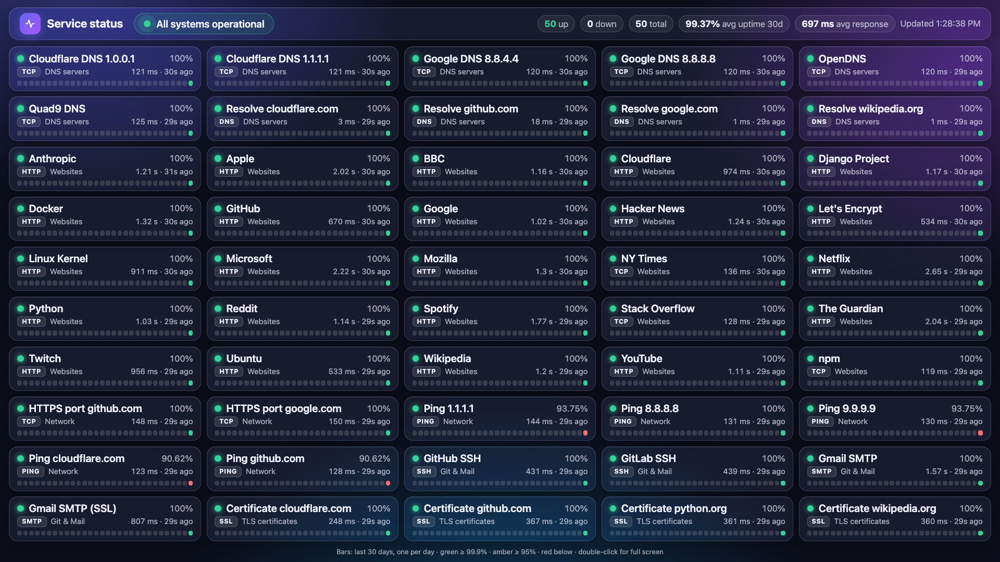
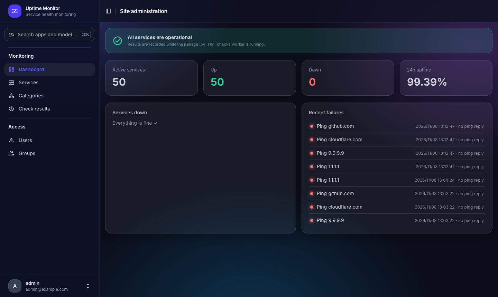
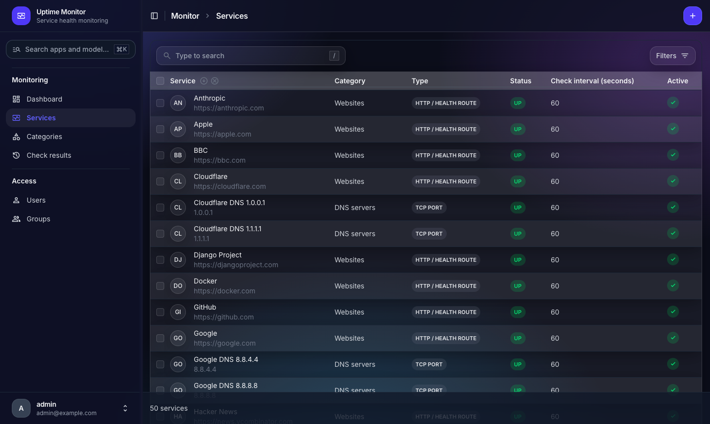
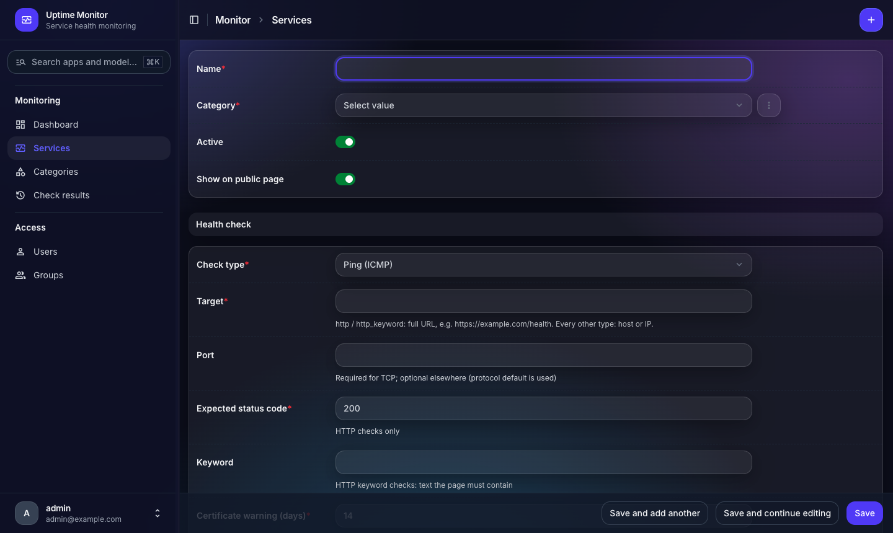

# Uptime Monitor

A small, self-hosted uptime monitor built with **Django**, **Django Ninja** and the **Unfold** admin.
Define services in the admin, choose how each one is health-checked, and a background worker records the
results. A public, TV-friendly status page shows only what matters: **is it up, and for how long**. No hosts,
ports or error messages are ever exposed.



## Features

- **11 check types:** ping, TCP port, HTTP status, HTTP keyword, DNS, SSL certificate expiry, SSH, SMTP, Redis,
  PostgreSQL and MySQL/MariaDB.
- **Categories:** group services however you like; the order is configurable.
- **Background worker:** every service runs on its own interval and timeout, checks run in parallel, and old
  results are pruned automatically.
- **Public status page (`/`):** a glass-style grid that scales to the screen, so all services fit on a TV without
  scrolling. Problems sort first, each tile has a 30-day history bar, and it refreshes itself every 30 seconds.
  Double-click for full screen.
- **Public JSON API (`/api/status`):** the same data the page uses, cached for 15 seconds.
- **Modern admin (`/admin/`):** Unfold theme with a custom glass skin, a dashboard with live counters and recent
  failures, status badges, search and filters.
- **Safe by default:** the public side never returns targets, ports or error details.
  Per-service `show on public page` switch.

## Screenshots

| Admin dashboard | Services |
| --- | --- |
|  |  |

| Add a service | Login |
| --- | --- |
|  |  |

## Check types

| Type | Target | Healthy when |
| --- | --- | --- |
| `ping` | host or IP | the system `ping` gets a reply |
| `tcp` | host or IP + **port** | a TCP connection opens |
| `http` | full URL | the response status equals the expected code (default `200`, redirects followed) |
| `http_keyword` | full URL + **keyword** | expected status **and** the first 1 MB of the body contains the keyword |
| `dns` | hostname | the name resolves |
| `ssl_cert` | host (default port 443) | the certificate chain is valid and expires in more than `warn_days` (default 14) |
| `ssh` | host (default port 22) | the server answers with an `SSH-` banner |
| `smtp` | host (default port 25; 465 uses SSL) | the server greets and answers `NOOP` |
| `redis` | host (default port 6379) | `PING` returns `+PONG` (or `-NOAUTH`, meaning it is alive but needs a password) |
| `postgres` | host (default port 5432) | answers the protocol's SSL handshake request |
| `mysql` | host (default port 3306) | sends a MySQL protocol-10 greeting |

Every check has a per-service **interval** (minimum 10 s) and **timeout**. HTTPS verification uses the bundled
[`certifi`](https://pypi.org/project/certifi/) CA store, so it works the same on every OS.

## Quick start

Requires Python 3.10+ (developed on 3.14).

```bash
git clone <your-fork-url> uptime-monitor && cd uptime-monitor
python3 -m venv .venv
.venv/bin/pip install -r requirements.txt

export DEBUG=1                              # local development only, see "Configuration" for production
.venv/bin/python manage.py migrate
.venv/bin/python manage.py createsuperuser
.venv/bin/python manage.py seed_demo        # optional: 50 services that monitor well-known public hosts

.venv/bin/python manage.py runserver        # terminal 1: status page at /, admin at /admin/
.venv/bin/python manage.py run_checks       # terminal 2: the background worker
```

Open <http://localhost:8000/> for the status page and <http://localhost:8000/admin/> to manage services.
Results appear as soon as the worker has completed its first cycle.

> **The worker is a separate process.** The web server only reads results; nothing is checked unless
> `manage.py run_checks` is running. `manage.py run_checks --once` checks every active service once and exits,
> which is handy for cron jobs and debugging.

### Adding your first service

1. In the admin, create a **Category** (for example "Production").
2. Create a **Service**, pick a **check type**, enter the **target** (a hostname, or a URL for HTTP checks) and save.
   Fields that don't apply to the chosen type are ignored.
3. Within one interval it appears on the status page.

## Configuration

All settings are environment variables.

| Variable | Default | Purpose |
| --- | --- | --- |
| `SECRET_KEY` | none, **required** unless `DEBUG=1` | Django secret key |
| `DEBUG` | off | set to `1` for local development only |
| `ALLOWED_HOSTS` | `localhost,127.0.0.1` | comma-separated host names |
| `CSRF_TRUSTED_ORIGINS` | none | comma-separated origins, e.g. `https://status.example.com` (needed behind HTTPS proxies) |
| `DB_PATH` | `./db.sqlite3` | SQLite database file |
| `TIME_ZONE` | `Asia/Tehran` | used for the daily history buckets and the admin |
| `RESULT_RETENTION_DAYS` | `90` | raw check results older than this are deleted |

## Public API

`GET /api/status` (no authentication, cached for 15 s):

```json
{
  "overall": "up",
  "updated_at": "2026-11-08T13:28:38Z",
  "categories": [
    {
      "name": "Websites",
      "services": [
        {
          "name": "GitHub",
          "kind": "HTTP",
          "status": "up",
          "latency_ms": 670.2,
          "uptime_30d": 99.8,
          "last_checked": "2026-11-08T13:28:30Z",
          "days": [{ "date": "2026-11-08", "uptime": 100.0 }]
        }
      ]
    }
  ]
}
```

`overall` is `up`, `degraded` (at least one service is down) or `unknown` (no results yet). `status` is
`up`, `down` or `unknown`. The response never includes targets, ports, hostnames or error text.

## Deploying

Run **two processes** against the same database, plus a reverse proxy:

```bash
export SECRET_KEY='<long random string>' ALLOWED_HOSTS=status.example.com \
       CSRF_TRUSTED_ORIGINS=https://status.example.com DB_PATH=/var/lib/uptime/db.sqlite3

.venv/bin/python manage.py migrate
.venv/bin/python manage.py collectstatic --noinput

.venv/bin/gunicorn config.wsgi --bind 127.0.0.1:8000    # web
.venv/bin/python manage.py run_checks                   # worker (keep it alive with systemd or supervisor)
```

- Serve `/static/` from the `staticfiles/` directory with your reverse proxy (nginx, Caddy, ...).
  The admin theme needs those files.
- Terminate HTTPS at the proxy and forward to gunicorn.
- Back up the SQLite file, or point `DATABASES` at PostgreSQL in `config/settings.py` for heavier use.

Example systemd unit for the worker:

```ini
[Service]
WorkingDirectory=/srv/uptime-monitor
EnvironmentFile=/etc/uptime-monitor.env
ExecStart=/srv/uptime-monitor/.venv/bin/python manage.py run_checks
Restart=always
```

## Security notes

- **Admins decide what the server probes.** Check targets are entered in the admin, and checks run from the
  server's network, so a malicious admin could point a check at internal addresses. Only give admin access to
  people you trust.
- Hostnames are validated before ping/TCP checks, and the `ping` command is invoked with a fixed argument list.
- The public page and API intentionally omit everything except name, category, check kind, status, response time
  and uptime percentages. Use the `show on public page` switch to keep a service private.
- `SECRET_KEY` is mandatory outside `DEBUG`, and the app refuses to start without it.

## Development

```bash
.venv/bin/python manage.py test
```

The suite covers each protocol check against local fake servers, validation rules, the worker's cycle, the demo
seed and the public API, including a test that sensitive values never leak.

```
config/                  Django project (settings, urls, wsgi)
monitor/
  models.py              Category, Service, CheckResult
  checks.py              one function per check type + run_check()
  api.py                 public /api/status (Django Ninja)
  admin.py               Unfold admin classes and status badges
  dashboard.py           context for the admin home page
  management/commands/   run_checks (worker), seed_demo
  templates/monitor/     public status page
  static/monitor/        admin glass theme
templates/admin/         admin home page template
docs/screenshots/        images used in this README
```

To add a check type: add a value to `Service.CheckType`, write a function in `monitor/checks.py` that returns
`""` when healthy or a short reason when not, register it in `_CHECKS`, and add a label in `monitor/api.py`.
An import-time assertion fails if a type has no implementation.
